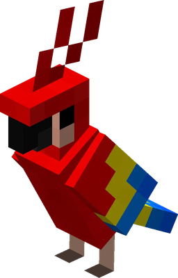

# Macaw Launcher

**A fast Minecraft launcher with the Macaw Client built in.**
One install, every version from 1.7.10 to the latest – zoom, freelook, waypoints, a world map and an FPS boost, ready the moment you press Play.

## Download

1. Download **[Macaw-Launcher-Setup.exe](https://github.com/Tchipple/macaw-launcher-releases/releases/latest/download/Macaw-Launcher-Setup.exe)**.
2. Run it and click **Install**.
3. Sign in with the Microsoft account you bought Minecraft with and press **Play**.

> Windows 10 and 11 · about 150 MB · free

## Features

| | |
|---|---|
| 🚀 **One install** | Java, mod loaders and the client are set up for you. |
| 🧩 **30+ built-in modules** | Toggle everything in game from the Macaw menu – no mod hunting. |
| ⚡ **FPS Boost** | One switch for every performance feature: built-in optimisations, entity culling, dynamic FPS and more. |
| 🔍 **Zoom & Freelook** | Zoom on <kbd>C</kbd>, orbit the camera on <kbd>Alt</kbd>. |
| 🗺️ **Waypoints & World Map** | Your own markers and a full-screen map of everything you explored. |
| 🎯 **PvP tools** | Custom crosshair, hitboxes, hit colour, 1.7 animations, Auto-GG. |
| 🧱 **Every version** | 1.7.10 to the latest release on Fabric, Forge and NeoForge. |
| 👥 **Accounts** | Several Microsoft accounts in one click, plus offline profiles for LAN. |

## Automatic updates

Already installed? You don't need to download anything again. Macaw Launcher checks for new versions when it starts, downloads them in the background and shows **Restart to update** in the title bar.

Every update is signed – the launcher only installs updates published here.

## Release notes

See the [Releases](https://github.com/Tchipple/macaw-launcher-releases/releases) page for what changed in each version.

---

Not an official Minecraft product. Not approved by or associated with Mojang or Microsoft.

